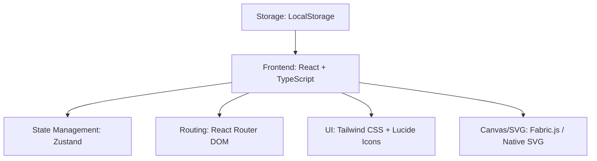
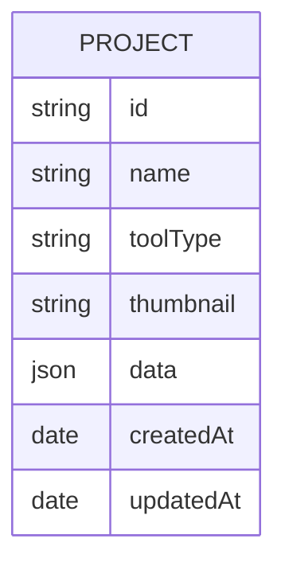

## 1. Architecture Design

## 2. Technology Description
- Frontend: React@18 + TypeScript + Vite
- Initialization Tool: vite-init with react-ts template
- Backend: None (local storage only)
- State Management: Zustand for app state
- Routing: React Router DOM for navigation
- UI: Tailwind CSS for styling, Lucide React for icons
- Canvas Library: Fabric.js for photo editor
- SVG: Native SVG for vector editor
- Storage: LocalStorage for project persistence

## 3. Route Definitions
| Route | Purpose |
|-------|---------|
| / | Home dashboard |
| /pixelcraft | Photo editor |
| /vectorverse | Vector editor |

## 4. API Definitions (if backend exists)
Not applicable (no backend).

## 5. Server Architecture Diagram (if backend exists)
Not applicable (no backend).

## 6. Data Model (if applicable)
### 6.1 Data Model Definition

### 6.2 Data Definition Language
Not applicable (using LocalStorage).
