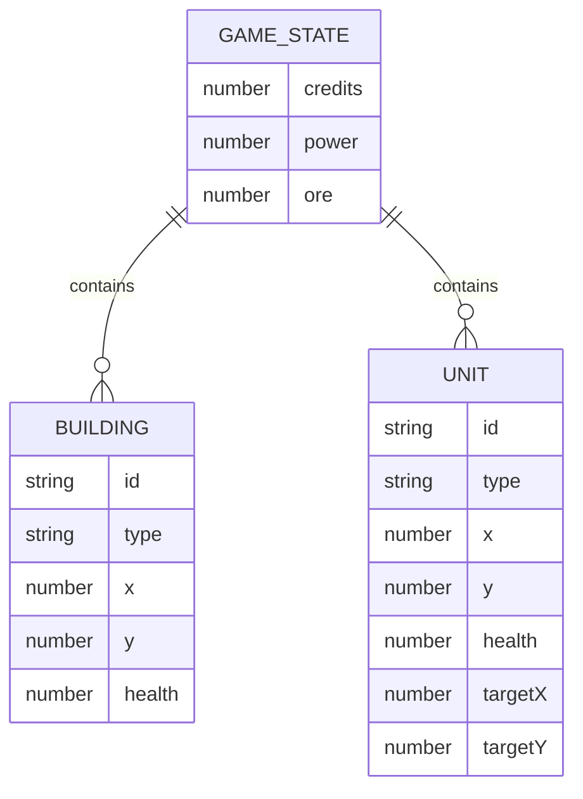

# Red Alert Game - Technical Architecture Document

## 1. Architecture Design
```mermaid
graph TD
    A[Browser] --> B[React Frontend]
    B --> C[HTML5 Canvas Game Engine]
    C --> D[Game State Management (Zustand)]
    D --> E[Rendering Loop]
```

## 2. Technology Description
- Frontend: React@18 + TypeScript + tailwindcss@3 + vite
- Initialization Tool: vite-init
- Backend: None (single-player, browser-only)
- Database: None (no persistent storage needed for MVP)

## 3. Route Definitions
| Route | Purpose |
|-------|---------|
| / | Main menu page |
| /game | Gameplay page |

## 4. API Definitions
Not applicable - no backend API.

## 5. Server Architecture Diagram
Not applicable - no backend.

## 6. Data Model
### 6.1 Data Model Definition


### 6.2 Data Definition Language
Not applicable - no database.
