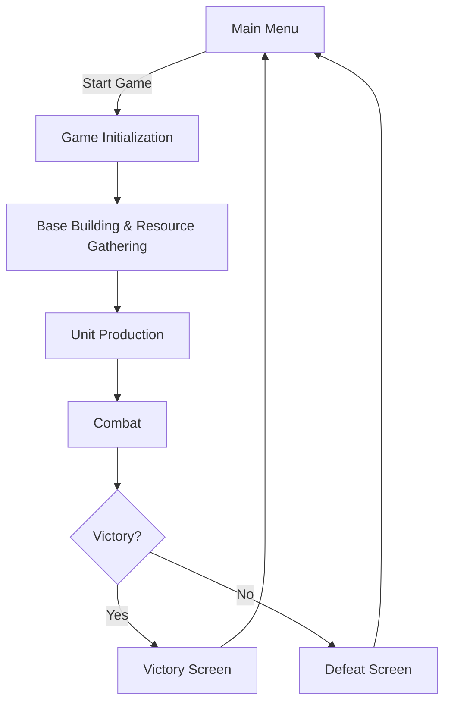

# Red Alert Game - Product Requirements Document

## 1. Product Overview
A web-based real-time strategy (RTS) game inspired by Command & Conquer: Red Alert, featuring base building, resource management, unit production, and tactical combat.
- Target users: RTS game fans, casual gamers looking for a browser-based strategy experience
- Market value: Brings classic RTS gameplay to the web with modern design and smooth performance

## 2. Core Features

### 2.1 User Roles
Not applicable - single-player game with no user roles.

### 2.2 Feature Module
1. **Main Menu**: Title, start game, options
2. **Gameplay Page**: Game canvas, resource display, building/unit controls, minimap
3. **Pause/Game Over Screen**: Pause menu, victory/defeat conditions

### 2.3 Page Details
| Page Name | Module Name | Feature description |
|-----------|-------------|---------------------|
| Main Menu | Title Section | Game title with animated effects, start button |
| Main Menu | Options | Volume controls, difficulty selection |
| Gameplay Page | Game Canvas | Rendered using HTML5 Canvas, shows terrain, buildings, units |
| Gameplay Page | Resource Display | Shows credits, power, ore |
| Gameplay Page | Build Menu | Allows selecting and placing buildings/units |
| Gameplay Page | Minimap | Small overview of the map |
| Gameplay Page | Unit Control | Select units, issue commands |

## 3. Core Process
1. User starts the game from the main menu
2. Game initializes map, resources, and starting units
3. User builds structures, gathers resources, produces units
4. User engages enemy forces in combat
5. Game ends with victory or defeat

## 4. User Interface Design
### 4.1 Design Style
- Primary colors: Red (#ff4444), Dark Blue (#0d1b2a), Gray (#333333)
- Button style: Industrial, squared with metallic borders, hover effects
- Fonts: Use Orbitron for headers, Roboto Mono for body/text
- Layout style: HUD-style with top/bottom bars, canvas in center
- Icon/emoji style: Military/industrial themed icons (tanks, buildings, etc.)

### 4.2 Page Design Overview
| Page Name | Module Name | UI Elements |
|-----------|-------------|-------------|
| Main Menu | Hero Section | Centered layout, animated title, glowing buttons, dark background with grid effect |
| Gameplay Page | HUD | Top bar for resources, bottom bar for build menu, side panel for unit info |
| Gameplay Page | Canvas | Dark terrain with grid, buildings/units with distinct colors, particle effects for explosions |

### 4.3 Responsiveness
Desktop-first, optimized for 1080p and above, touch support for tablet devices.

### 4.4 3D Scene Guidance
Not applicable - 2D canvas game.
