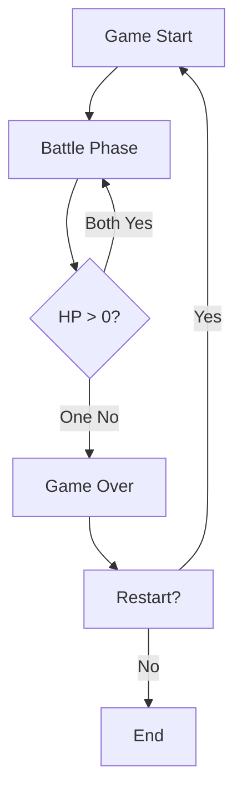

## 1. Product Overview
Pixel Mecha Battle is a retro-style 2D fighting game where two mecha characters face off in a simple arena. The game features basic movement, attacks, defense, and a win/loss system with pixel art graphics and animations.

## 2. Core Features

### 2.1 User Roles
No specific user roles - this is a single-player or local 2-player game.

### 2.2 Feature Module
1. **Battle Arena**: Main gameplay screen with two mecha characters, arena background, and UI elements
2. **Controls**: Keyboard controls for both players (move, attack, defend)
3. **Health System**: HP bars for both mechas
4. **Win/Loss Condition**: Game ends when one mecha's HP reaches 0
5. **Game Reset**: Option to restart the battle

### 2.3 Page Details
| Page Name | Module Name | Feature description |
|-----------|-------------|---------------------|
| Battle Arena | Mecha Characters | Two pixel art mechas with basic animations (idle, move, attack, defend) |
| Battle Arena | Movement System | Horizontal movement, jumping |
| Battle Arena | Combat System | Basic attacks, defense blocks |
| Battle Arena | Health Display | HP bars showing current health for both mechas |
| Battle Arena | Game Over Screen | Displays winner and restart option |

## 3. Core Process
1. Game starts with both mechas at full health
2. Players control their mechas using keyboard
3. Mechas can move, attack, and defend
4. Attacks deal damage to opponent if not blocked
5. Game ends when one mecha's HP reaches 0
6. Winner is displayed, and player can restart

## 4. User Interface Design
### 4.1 Design Style
- **Visual Style**: Retro pixel art (8-bit / 16-bit aesthetic)
- **Colors**:
  - Primary: #1a1a2e (dark blue) - background
  - Secondary: #16213e (dark blue-gray) - UI panels
  - Accent 1: #0f3460 (blue) - Player 1 mecha
  - Accent 2: #e94560 (red) - Player 2 mecha
  - Text: #eeeeee (light gray)
- **Font**: Pixel-style font (Courier New or monospace)
- **Buttons**: Pixelated borders, solid colors, hover effects
- **Layout**: Centered battle arena with top UI for HP bars

### 4.2 Page Design Overview
| Page Name | Module Name | UI Elements |
|-----------|-------------|-------------|
| Battle Arena | Arena Background | Simple pixel art ground and sky |
| Battle Arena | HP Bars | Horizontal bars above each mecha, color-coded |
| Battle Arena | Controls Info | Small text display showing key bindings |
| Battle Arena | Game Over | Centered overlay with winner text and restart button |

### 4.3 Responsiveness
- Desktop-first design
- Canvas-based game that scales with window size
- Keyboard controls optimized for desktop
