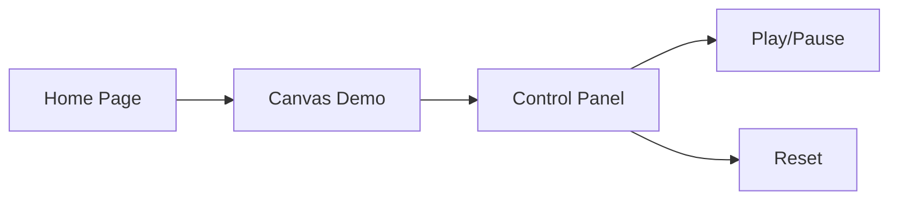

# Game Engine - Product Requirements Document

## 1. Product Overview
A lightweight, browser-based 2D game engine built with React and Canvas, providing core game development tools like sprite rendering, physics, input handling, and scene management. Targets hobbyist game developers who want to build simple 2D games quickly.

## 2. Core Features

### 2.2 Feature Module
1. **Engine Demo Page**: Interactive demo showcasing engine capabilities
2. **Scene Editor**: Basic scene setup and object placement
3. **Game Canvas**: Real-time game rendering canvas with play/pause controls

### 2.3 Page Details
| Page Name | Module Name | Feature description |
|-----------|-------------|---------------------|
| Engine Demo | Hero Section | Animated introduction to the engine |
| Engine Demo | Canvas Demo | Interactive 2D canvas with sprites and physics |
| Engine Demo | Controls Panel | Play/pause, reset, and configuration options |

## 3. Core Process
User navigates to demo page → interacts with canvas controls → sees engine features in real-time.

## 4. User Interface Design
### 4.1 Design Style
- Primary color: Deep space blue (#0a0e27)
- Secondary accent: Electric cyan (#00d4ff)
- Button style: Neon glow with rounded corners
- Font: Space Grotesk for headings, JetBrains Mono for code
- Layout style: Dark theme with grid-based sections
- Icon style: Minimalist, tech-focused icons

### 4.2 Page Design Overview
| Page Name | Module Name | UI Elements |
|-----------|-------------|-------------|
| Engine Demo | Hero Section | Animated gradient background, floating particles |
| Engine Demo | Canvas Demo | Responsive canvas, pixelated style |
| Engine Demo | Controls Panel | Glassmorphism UI, glowing buttons |

### 4.3 Responsiveness
Desktop-first design with mobile adaptation, touch controls for canvas interactions.

