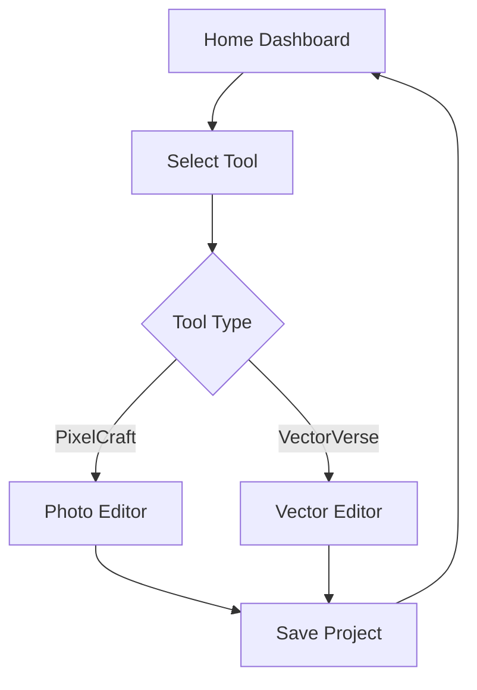

## 1. Product Overview
A modern, web-based creative suite inspired by Adobe Creative Cloud, featuring multiple creative tools (photo editor, vector editor, etc.) with a beautiful, professional UI. Target users are creative professionals and hobbyists.

## 2. Core Features

### 2.1 User Roles (if applicable)
| Role | Registration Method | Core Permissions |
|------|---------------------|------------------|
| Normal User | Local storage-based | Access all creative tools |

### 2.2 Feature Module
1. **Home Dashboard**: Creative Cloud-style home screen with recent projects and tool launcher
2. **Photo Editor (PixelCraft)**: Canvas-based photo editor with layers, filters, and tools
3. **Vector Editor (VectorVerse)**: SVG-based vector editor with shapes, paths, and gradients
4. **Color Picker**: Advanced color picker with palettes and harmony modes

### 2.3 Page Details
| Page Name | Module Name | Feature description |
|-----------|-------------|---------------------|
| Home Dashboard | Tool Launcher | Grid of creative tools with hover animations |
| Home Dashboard | Recent Projects | List of recently opened projects with thumbnails |
| Photo Editor | Canvas Layer System | Layer management with visibility, opacity, and blending modes |
| Photo Editor | Toolbar | Selection, brush, eraser, shape, text tools |
| Vector Editor | Path Editor | Bezier curve editing with anchor points |
| Color Picker | Harmony Modes | Complementary, triadic, tetradic color harmony |

## 3. Core Process
User opens the app → selects a tool from the home dashboard → creates or opens a project → edits using the tool's features → saves the project locally.

## 4. User Interface Design
### 4.1 Design Style
- Primary Colors: Deep navy (#0F172A) as background, bright cyan (#22D3EE) as accent
- Secondary Colors: Slate blue (#64748B) for text and secondary UI
- Buttons: Rounded, with subtle shadows and hover animations
- Font: Inter for body, Space Grotesk for headings
- Layout: Left sidebar for navigation/tools, main content area for canvas
- Icons: Lucide React icons for clean, modern look

### 4.2 Page Design Overview
| Page Name | Module Name | UI Elements |
|-----------|-------------|-------------|
| Home Dashboard | Hero | Gradient background, large title, subtle animations |
| Home Dashboard | Tool Grid | Card-based tool tiles with icons and descriptions |
| Photo Editor | Layer Panel | Vertical list of layers with controls |
| Photo Editor | Canvas | Central workspace with grid background |

### 4.3 Responsiveness
Desktop-first design, with responsive breakpoints for tablet and mobile. Touch-friendly controls for mobile devices.

### 4.4 3D Scene Guidance (if applicable)
Not applicable for this project.
